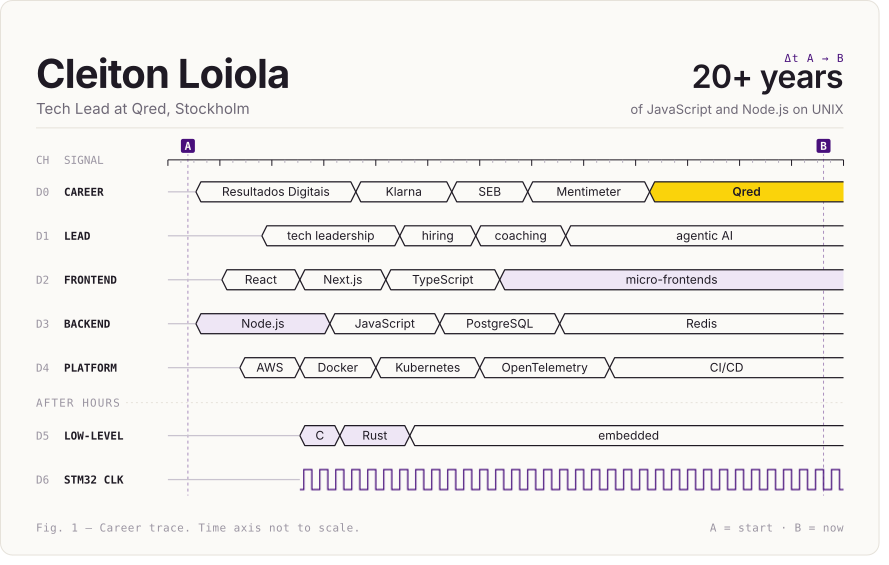

**Cleiton Loiola**, Tech Lead at [Qred](https://www.qred.com) in Stockholm, leading the Acquisition team and building agentic AI tooling for engineers. 20+ years of JavaScript and Node.js on UNIX, previously at Mentimeter, SEB, Klarna and Resultados Digitais, where I wrote Front Hub, a micro-frontend framework now powering 500+ micro-frontends. Full story in my [resume](https://github.com/klaygomes/resume/blob/main/cleiton-loiola.md).

After hours, for fun: C, Rust and STM32 microcontrollers.

Reach me at [email@cleiton.dev](mailto:email@cleiton.dev) or on [LinkedIn](https://www.linkedin.com/in/klaygomes).

<h3></h3>

**[TinyTroop](https://tinytroop.estacouveflor.com)**: free planning poker that shows who should explain first when votes differ ([blog](https://tinytroop.estacouveflor.com/blog/)).

**[hurl-orchestra](https://github.com/klaygomes/hurl-orchestra)**: a dependency-aware task runner for Hurl API tests ([docs](https://www.estacouveflor.com/hurl-orchestra/), [article](https://www.estacouveflor.com/hurl-orchestra-ai-first-api-testing/)).

<h3></h3>

**Frontend**
- [Front Hub](https://front-hub.rdstation.com.br/): a micro-frontend framework and CLI I wrote at Resultados Digitais, now powering 500+ micro-frontends
- [mini-react](https://github.com/klaygomes/mini-react): a tiny React-like library to see what happens under the hood ([article](https://www.estacouveflor.com/mini-react/))
- [magic-cursor-wand](https://github.com/klaygomes/magic-cursor-wand): chalk lines, glitter and clouds that follow your pointer ([docs](https://www.estacouveflor.com/magic-cursor-wand/), [article](https://www.estacouveflor.com/magic-cursor-wand-pointer-effects/))
- [geo-location](https://github.com/klaygomes/geo-location): a take-home challenge with React, Redux and Sagas ([article](https://www.estacouveflor.com/geo-location/))

**Tooling**
- [karma-typescript-preprocessor2](https://github.com/klaygomes/karma-typescript-preprocessor2): TypeScript tests in Karma without temp files ([article](https://www.estacouveflor.com/karma-typescript-preprocessor2/))
- [dotfiles](https://github.com/klaygomes/dotfiles): GNU Make as a dotfiles manager ([article](https://www.estacouveflor.com/dotfiles-configuration/), [tmux PR menu](https://github.com/klaygomes/dotfiles/blob/master/docs/tmux-pr-menu.md))
- [resume](https://github.com/klaygomes/resume): my resume in groff, rendered to PDF, terminal text and markdown

**Low-level, as a hobby**
- [mini-painel](https://github.com/klaygomes/mini-painel): talking to a tiny USB screen in C ([docs](https://github.com/klaygomes/mini-painel/tree/main/doc), [article](https://www.estacouveflor.com/mini-painel/))

<h3></h3>

**[Esta couve flor](https://www.estacouveflor.com/articles/)**: the whole stack, from React on the screen down to the clock tree of an STM32. 
Start with [the STM32 clock system](https://www.estacouveflor.com/entendendo-coracao-stm32/), [how CALLs use the stack](https://www.estacouveflor.com/como-calls-fazem-uso-stack-post/) or [async and await](https://www.estacouveflor.com/async-e-await/).

**[TinyTroop blog](https://tinytroop.estacouveflor.com/blog/)**: estimation and refinement for agile teams. 
Start with [anchoring bias in estimation](https://tinytroop.estacouveflor.com/blog/anchoring-bias-in-estimation/) or [running your first planning poker session](https://tinytroop.estacouveflor.com/blog/how-to-run-planning-poker-first-session/).

 

